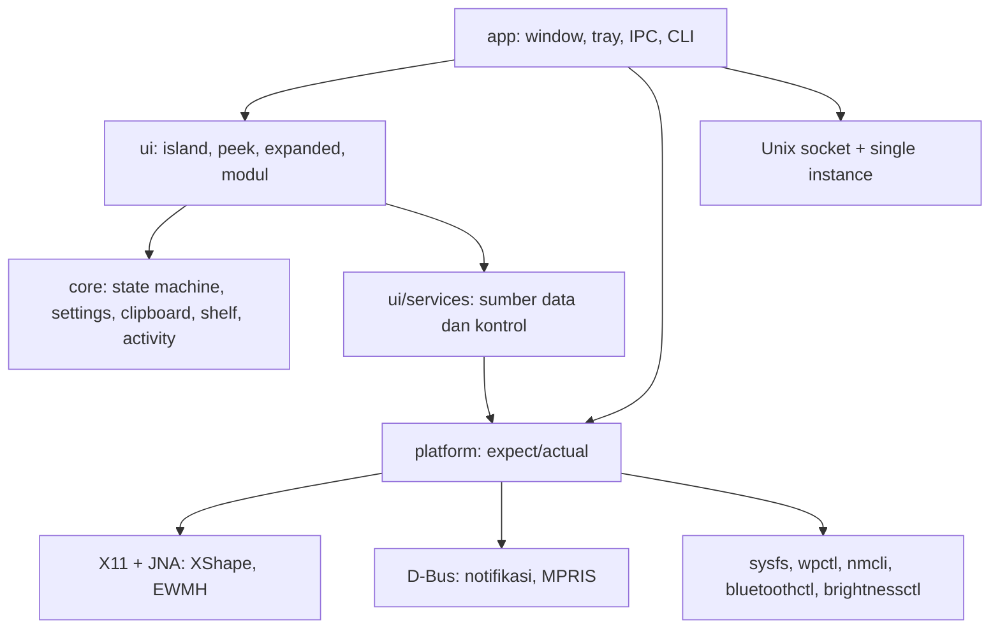

<div align="center">

# X-Tray

**Dynamic Island untuk desktop Linux: satu panel kecil di tengah atas layar yang membesar saat dibutuhkan.**

[](https://kotlinlang.org/)
[](https://www.jetbrains.com/compose-multiplatform/)
[](https://m3.material.io/)
[](https://adoptium.net/)
[](https://gradle.org/)
[](https://kernel.org/)
[](https://github.com/andreasmlbngaol/x-tray/releases)
[](./LICENSE)


</div>

X-Tray menaruh satu panel kecil di tepi atas layar, tepat di tengah. Saat
diam ia hanya menampilkan jam, kecepatan jaringan, dan baterai. Saat kursor
menghampirinya ia membuka peek: jam bertumpuk, kontrol media, dan notifikasi
terbaru. Saat diklik ia membuka expanded: rail modul dengan clipboard, shelf,
timer fokus, kontrol sistem, dan pengaturan.

Aplikasi ini juga mengambil alih `org.freedesktop.Notifications`. Popup
notifikasi bawaan desktop berhenti muncul dan semua notifikasi masuk ke island,
jadi hanya ada satu tempat untuk melihat apa yang baru terjadi. Kalau tidak
ingin, pengambilalihan bisa dimatikan di Settings.

## Isi

- [Apa yang dilakukannya](#apa-yang-dilakukannya)
- [Tiga level](#tiga-level)
- [Stack](#stack)
- [Cara kerjanya](#cara-kerjanya)
- [Struktur proyek](#struktur-proyek)
- [Menjalankan](#menjalankan)
- [Memakai aplikasi](#memakai-aplikasi)
- [Variabel lingkungan](#variabel-lingkungan)
- [Penyimpanan dan privasi](#penyimpanan-dan-privasi)
- [Batasan yang diketahui](#batasan-yang-diketahui)
- [Lisensi](#lisensi)

## Apa yang dilakukannya

- **Tiga level informasi.** Collapsed untuk hal yang paling sering dilihat,
  peek untuk detail, expanded untuk semuanya.
- **Media (MPRIS).** Judul, artis, album, progres, dan kontrol
  putar/jeda/berikutnya/sebelumnya lewat `busctl`. Kontrolnya juga tersedia di
  peek supaya tidak perlu membuka expanded.
- **Clipboard.** Riwayat teks di memori, klik untuk menyalin ulang, plus switch
  untuk menjeda penangkapan.
- **Shelf.** Tarik file ke island. Gambar dan video tampil sebagai thumbnail,
  file lain tampil sebagai nama dan ikon. Tombol open/delete muncul saat hover,
  dan item tetap bisa ditarik keluar ke file manager.
- **Timer fokus.** Durasi bisa diketik dalam jam/menit/detik, hitung mundur
  menampilkan sisa waktu dan jam selesai, dan tampil besar di peek selama sesi
  berjalan.
- **Kontrol sistem.** Volume, kecerahan, mute, mic, Wi-Fi, Bluetooth, dan DND.
  Status dibaca dari warna, bukan label "On/Off".
- **Power menu.** Suspend, reboot, dan shutdown dari header expanded, dengan
  konfirmasi.
- **Notifikasi.** Mengambil alih `org.freedesktop.Notifications` selama
  berjalan, lalu mengembalikannya saat keluar. Notifikasi tampil sebagai kartu
  saat collapsed, di baris bawah saat peek, dan sebagai banner saat expanded.
- **Window.** Transparan, tanpa dekorasi, selalu di atas, tidak muncul di
  taskbar, dan click-through di luar bentuk island.
- **Dormant.** Saat ada window fullscreen atau maximized, island mengecil jadi
  garis 120x6 di tengah atas. Hover membukanya lagi; klik kanan juga
  mengecilkannya ke garis yang sama.
- **Single instance, tray, autostart, dan CLI** lewat Unix socket.

## Tiga level


| Level | Ukuran | Isi |
|---|---|---|
| Collapsed | 300x38 dp | Jam, tanggal, kecepatan upload/download, baterai |
| Peek | 420x140 dp | Jam bertumpuk, media, kecepatan jaringan, notifikasi terbaru |
| Notifikasi | 384x100 dp | Nama aplikasi, judul, isi, tombol tutup |
| Expanded | 460x620 dp | Rail modul dan konten modul aktif |
| Dormant | 120x6 dp | Garis tipis yang tetap bisa di-hover |

Semua ukuran ada di `IslandDimens`, dan bentuknya digambar oleh `IslandShape`:
tepi atas menempel ke layar, bahu cekung, sudut bawah membulat.

## Stack

### Aplikasi

- Kotlin 2.4.21 dan Compose Multiplatform 1.13.0.
- Material 3 Expressive (`MaterialExpressiveTheme`, `MotionScheme.expressive()`,
  `ButtonGroup`, `LinearWavyProgressIndicator`, `MaterialShapes`).
- JNA 5.17.0 untuk X11: XShape input region, EWMH, dan `_NET_WM_STATE`.
- dbus-java 5.2.2 untuk daemon notifikasi dan MPRIS.
- kotlinx.serialization untuk pengaturan dan perintah IPC, kotlinx.coroutines
  untuk polling dan animasi.

### Build dan rilis

- Gradle 9.8.1, JDK 21, Kotlin Multiplatform dengan target JVM.
- jpackage lewat plugin Compose untuk membuat `.deb`.
- ProGuard 7.8.0 pada build release: shrink dan optimize, tanpa obfuscate.
  Ukuran `.deb` turun dari 90 MB ke 43 MB.
- GitHub Actions membangun, menguji, dan mengunggah `.deb` ke tab Releases
  setiap kali ada tag `v*`.

## Cara kerjanya

Empat modul Gradle memisahkan logika, UI, dan akses sistem. `core` tidak
menyentuh sistem sama sekali, jadi state machine, pengaturan, dan penyimpanan
bisa diuji tanpa desktop.



Beberapa keputusan yang menentukan bentuk kode:

- **State machine eksplisit.** `IslandStateMachine` menerima permintaan
  (`Hover`, `Click`, `Collapse`, `Expand`, `Hide`) dan memutuskan state
  berikutnya, termasuk jeda hover dan jeda tutup. UI hanya merender hasilnya.
- **Ukuran per state.** Setiap state punya ukuran desain sendiri dan diukur
  dengan `requiredSize` sebelum dianimasikan. Ini menghindari konten state lama
  diukur di kotak state baru, yang sebelumnya membuat Compose melempar
  `maxWidth(-6)`.
- **Window tidak pernah di-unmap.** Hide berarti mengecil ke garis dormant,
  bukan menyembunyikan window, sehingga hover tetap bisa membukanya kembali.
- **Click-through.** XShape memotong area input di luar bentuk island, jadi
  klik di sekitar island tetap sampai ke window di bawahnya.
- **Notifikasi yang bisa dikembalikan.** X-Tray meminta nama bus, dan kalau
  nama itu dipegang helper GNOME (`org.gnome.Shell.Notifications`), helper
  dihentikan hanya setelah `/proc/<pid>/cmdline` dipastikan milik helper itu.
  Saat keluar, nama dilepas dan helper diaktifkan lagi lewat D-Bus.
- **Satu sumber versi.** Tag `v1.0.0` menjadi `appVersion`, yang dipakai untuk
  `packageVersion` dan untuk `AppInfo.VERSION` di dalam aplikasi.

## Struktur proyek

```text
x-tray/
├─ app/                          Entry point, window, tray, CLI, packaging
│  ├─ proguard-rules.pro         Aturan shrink untuk JNA, dbus-java, serialization
│  ├─ icons/x-tray.png           Ikon aplikasi dan menu
│  └─ src/main/kotlin/…/app/
│     ├─ Main.kt                 Wiring window, tray, IPC, notifikasi
│     └─ …
├─ ui/                           Tema Expressive, bentuk island, modul
│  └─ src/commonMain/kotlin/…/ui/
│     ├─ theme/                  MaterialExpressiveTheme dan warna aksen
│     ├─ island/                 IslandShape, IslandDimens, konten per level
│     └─ modules/                Media, clipboard, shelf, fokus, kontrol, settings
├─ platform/                     expect/actual untuk akses sistem
│  ├─ commonMain/                Kontrak: WindowController, MediaSource, …
│  └─ jvmMain/                   X11/JNA, D-Bus, sysfs, MPRIS, IPC, autostart
├─ core/                         State machine, settings, clipboard, shelf, IPC
├─ docs/
│  ├─ design-notes.md            Token desain, ukuran, motion, alasan tiap pilihan
│  ├─ platform-notes.md          Temuan X11/Wayland, D-Bus, dan catatan rilis
│  └─ images/                    Screenshot untuk README
├─ .github/workflows/release.yml Build dan unggah .deb per tag
├─ gradle/libs.versions.toml     Version catalog
└─ LICENSE                       Apache 2.0
```

## Menjalankan

### Kebutuhan

- JDK 21.
- Linux dengan X11 atau Wayland (lewat XWayland).
- Opsional, sesuai fitur yang dipakai:
  - `busctl` (systemd) untuk MPRIS dan notifikasi
  - `wpctl` (PipeWire) untuk volume dan mic
  - `nmcli` untuk Wi-Fi
  - `bluetoothctl` untuk Bluetooth
  - `brightnessctl` untuk kecerahan

Fitur yang tool-nya tidak tersedia otomatis disembunyikan; aplikasi tetap
jalan.

### Build dan jalankan

```shell
./gradlew :app:run
```

Test:

```shell
./gradlew :core:jvmTest :platform:jvmTest
```

### Paket Debian

```shell
./gradlew :app:packageReleaseDeb
sudo apt install app/build/compose/binaries/main-release/deb/x-tray_1.0.0_amd64.deb
x-tray
```

Build release memakai ProGuard, jadi hasilnya sekitar 43 MB (tanpa minify
sekitar 90 MB). Versi diambil dari properti `appVersion` di
`gradle.properties`, dan CI menimpanya dengan nomor tag.

### Rilis otomatis

Setiap tag `v*` menjalankan `.github/workflows/release.yml`: test dijalankan,
`.deb` release di-build dan di-minify, lalu diunggah ke tab **Releases**.

```shell
git tag v1.0.0
git push origin v1.0.0
```

## Memakai aplikasi

1. **Hover** di island untuk membuka peek. Kursor keluar menutupnya setelah
   jeda singkat.
2. **Klik** untuk membuka expanded. Expanded hanya menutup lewat Esc, klik di
   luar, atau pindah window.
3. **Tarik file** ke island untuk menambahkannya ke shelf.
4. **Klik kanan** di island untuk mengecilkannya jadi garis dormant.
5. **Tray icon** menyediakan Buka, Ciutkan, DND, dan Keluar.
6. **CLI** mengirim perintah ke instance yang sedang berjalan:

```shell
x-tray toggle
x-tray expand
x-tray collapse
x-tray show
x-tray hide
x-tray state
x-tray quit
x-tray notify "Build selesai"
x-tray activity start 25 "Tulis laporan"
x-tray activity stop
x-tray dnd on
x-tray dnd off
```

Menjalankan aplikasi kedua tanpa argumen akan meneruskan `show` ke instance
yang sudah ada, bukan membuat window baru.

## Variabel lingkungan

| Variabel | Nilai | Keterangan |
|---|---|---|
| `XTRAY_RENDER_API` | `SOFTWARE`, `OPENGL` | Paksa backend renderer. Default: SOFTWARE di Wayland, OPENGL di X11. |
| `XTRAY_DEMO` | `cycle` | Driver sementara untuk menguji transisi tanpa pointer. |
| `XTRAY_DEBUG` | `1` | Log debug dan stack trace. |
| `XTRAY_EXEC` | path | Perintah yang ditulis ke entri autostart. |
| `XTRAY_MODULE` | id modul | Modul yang aktif saat island pertama dibuka. |
| `XTRAY_SHELF_SEED` | path1,path2 | Isi shelf saat start, untuk menguji drag-out. |

## Penyimpanan dan privasi

| Data | Lokasi | Catatan |
|---|---|---|
| Pengaturan | `~/.config/x-tray/settings.json` | JSON, bisa diedit manual |
| Log | `~/.local/state/x-tray/x-tray.log` | Dipotong saat melewati 1 MB |
| Socket IPC | `$XDG_RUNTIME_DIR/x-tray.sock` | Hanya untuk user yang sama |
| Lock instance | `~/.config/x-tray/instance.lock` | Advisory file lock |
| Clipboard | memori proses | Tidak ditulis ke disk |
| Shelf | memori proses | Hilang saat keluar |

Tidak ada telemetri dan tidak ada koneksi jaringan. Pengambilalihan notifikasi
hanya memakai bus sesi milik user.

Konsumsi saat diam, terukur pada Wayland dengan renderer software: sekitar 3%
satu inti CPU dan RSS sekitar 260 MB.

## Batasan yang diketahui

- Wayland native belum didukung; AWT berjalan lewat XWayland.
- Click-through memakai XShape, jadi hanya berlaku di X11/XWayland.
- Pengambilalihan notifikasi butuh helper notifikasi GNOME
  (`org.gnome.Shell.Notifications`). Desktop lain memakai mekanisme sendiri
  dan saat ini ditolak dengan aman: notifikasi asli dibiarkan hidup.
- Tray icon di GNOME butuh ekstensi AppIndicator.
- Clipboard dan shelf belum persisten.
- Timer fokus berhenti saat aplikasi ditutup.

## Lisensi

Kode X-Tray dilisensikan di bawah **Apache License 2.0**. Teks lengkapnya ada di
[LICENSE](./LICENSE).

Kalau kamu mendistribusikan ulang proyek ini atau versi modifikasinya, bagian 4
lisensi mewajibkan kamu menyimpan pemberitahuan hak cipta dan atribusi, serta
menyertakan salinan lisensi yang bisa dibaca. Berkas yang kamu ubah harus
ditandai sebagai telah diubah.

Aset pihak ketiga:

- Font **Google Sans Flex** dipakai dengan lisensi SIL Open Font License 1.1
  (`docs/licenses/google_sans_flex_OFL.txt`).
- PixelPlayer hanya dipelajari sebagai referensi desain. Kodenya proprietary,
  jadi tidak ada kode atau aset yang disalin.

Copyright 2026 Andreas M Lbn Gaol
