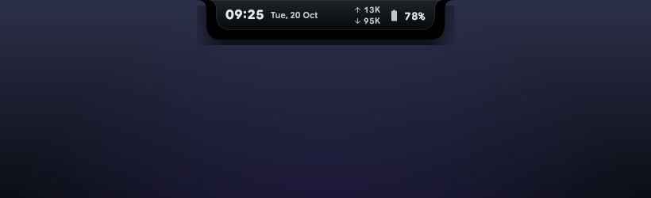
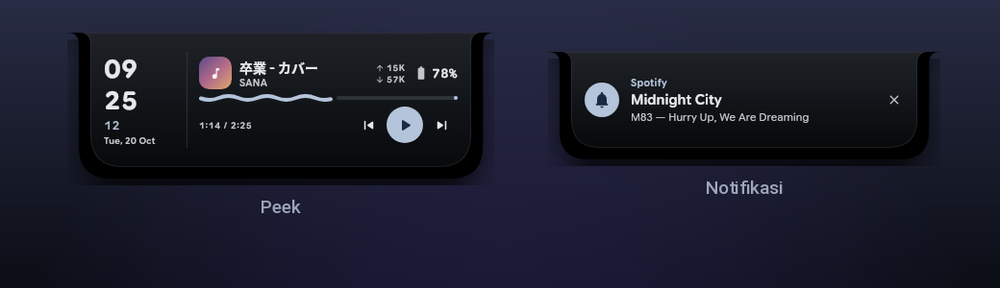
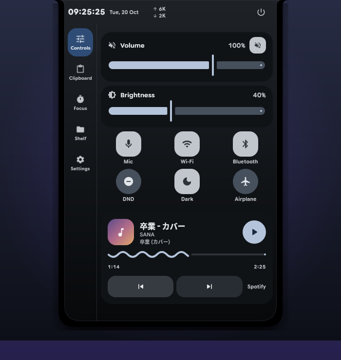

<div align="center">

# X-Tray

**A Dynamic Island for the Linux desktop.**

[](https://kotlinlang.org/)
[](https://www.jetbrains.com/compose-multiplatform/)
[](https://m3.material.io/)
[](https://kernel.org/)
[](https://github.com/andreasmlbngaol/x-tray/releases)
[](./LICENSE)



</div>

X-Tray is a single panel that sits at the top centre of your screen. At rest it
is only 300 px wide: the time, the date, network speed, and the battery. When
your pointer gets close it grows to show what is playing and the latest
notification, and when you click it, it opens fully with quick controls, the
clipboard, a focus timer, the shelf, and settings.

No window to keep around, no extra taskbar icon. Everything you usually look
for in five different places lives in one panel you can summon from the top
edge.

## What it does

- **Glanceable at rest.** Time, date, upload and download speed, battery.
- **Music without switching apps.** Title, artist, and album show up in peek,
  with play, previous, and next buttons.
- **One place for notifications.** X-Tray takes over desktop notifications, so
  the stock popups stop and everything lands in the island.
- **Volume and brightness.** Two sliders, plus mic, Wi-Fi, Bluetooth, do not
  disturb, dark mode, and airplane.
- **Clipboard history.** Every copied text stays in memory while the app runs;
  click one to copy it again.
- **A shelf for files.** Drag files onto the island, see thumbnails for images
  and videos, open or delete them on hover, and drag them back out.
- **Focus timer.** Type any duration, watch it count down in peek, get a
  notification when the session ends.
- **Out of the way when you want.** Right click shrinks it to a 120x6 hairline
  at the top edge; hovering brings it back.

## How you use it



| You do | What happens |
|---|---|
| Leave it alone | Small bar: time, date, network speed, battery |
| Move the pointer over it | Peek: stacked clock, music, latest notification |
| Click | Expanded: every module |
| Right click | Collapses to a hairline at the top edge |
| Drag a file onto it | The shelf opens and takes the file |
| Esc or click outside | Back to the small bar |

Peek closes by itself when the pointer leaves. Expanded only closes on Esc, a
click outside, or when you switch windows.

## The expanded panel



The rail on the left has five tabs, and **Controls** is the one that opens by
default:

- **Controls** — volume, brightness, mic, Wi-Fi, Bluetooth, do not disturb,
  dark mode, airplane mode, and the full music player right under the buttons.
- **Focus** — a focus timer with a duration you can type.
- **Clipboard** — text history, click to copy again.
- **Shelf** — the files you dragged onto the island.
- **Settings** — theme, accent colour, reduce motion, autostart, hover timing,
  notification takeover, and reset.

The header above holds the clock, the date, network speed, a power menu, and the
close button.

## Notifications

While X-Tray runs, it is the desktop notification receiver. When the bar is
small, a notification appears as a 384x100 card with the app name, title, body,
and a close button. In peek it shows on the bottom row. In expanded it becomes a
banner above the active module.

If you would rather keep the stock popups, turn off **Replace system
notifications** in Settings. When X-Tray exits, the desktop gets notifications
back on its own.

## Install

### From a release

Download the latest `.deb` from [Releases](https://github.com/andreasmlbngaol/x-tray/releases),
then:

```bash
sudo apt install ./x-tray_1.0.2_amd64.deb
```

Start **X-Tray** from your app menu. The package bundles its own Java runtime,
so you do not need a JDK.

### From source

You need JDK 21.

```bash
./gradlew :app:run
```

Build the package yourself:

```bash
./gradlew :app:packageReleaseDeb
```

## Quick commands

While the app is running, commands go to the same instance over a Unix socket:

```bash
x-tray toggle        # open or close the expanded panel
x-tray show          # bring the bar back
x-tray hide          # shrink to the hairline
x-tray notify "Hi"   # send a notification into the island
x-tray dnd on        # do not disturb
x-tray activity start 25 "Write the report"
x-tray quit
```

Running `x-tray` again with no arguments does not open a second window; it just
brings the running one forward.

## Settings worth knowing

| Setting | What it does |
|---|---|
| Theme | Follow the system, always light, or always dark |
| Accent colour | Five presets or your own HEX code |
| Reduce motion | Turns animations off |
| Autostart | Start X-Tray when you log in |
| Hide over maximized | Shrinks to the hairline while a maximized window is focused |
| Replace system notifications | Takes over desktop notifications |
| Hover and close delay | How quickly peek opens and closes |

## Notes

- Works on X11 and on Wayland through XWayland.
- Notification takeover relies on the GNOME notification helper. On other
  desktops X-Tray leaves the original notifications alone.
- The tray icon needs the AppIndicator extension on GNOME.
- Clipboard and shelf are kept in memory only, for as long as the app runs.

## License

X-Tray is licensed under the **Apache License 2.0**. See [LICENSE](./LICENSE).

The **Google Sans Flex** font is used under the SIL Open Font License 1.1
(`docs/licenses/google_sans_flex_OFL.txt`). PixelPlayer was studied as a design
reference only; none of its code or assets were copied.

Copyright 2026 Andreas M Lbn Gaol
